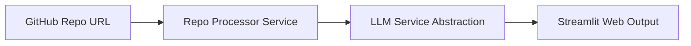

<p align="center">
  
</p>

<p align="center">
   
</p>


## 📌 Table of Contents
- [📖 Executive Summary](#-executive-summary)
- [✨ Key Features & Capabilities](#-key-features--capabilities)
- [🏗️ System Architecture & Workflow](#️-system-architecture--workflow)
- [🛠️ Tech Stack Breakdown](#️-tech-stack-breakdown)
- [⚙️ Reproducible Quickstart & Setup](#️-reproducible-quickstart--setup)
- [📂 Project Directory Layout](#-project-directory-layout)
- [👩‍💻 Author & Contributions](#-author--contributions)

---

## 📖 Executive Summary
### Problem Statement
Developers need rapid, lightweight code explanations directly from GitHub URLs without installing heavy desktop IDEs.

### Motivation & Solution Overview
A modular Streamlit microservice integrating GitHub repository cloning, file traversal, and LLM explanation services.

---

## ✨ Key Features & Capabilities
- **URL Parsing:** Clones public GitHub repositories into isolated temporary buffers.
- **LLM Service:** Modular LLM service abstraction formatting codebase explanations.

---

## 🏗️ System Architecture & Workflow


---

## 🛠️ Tech Stack Breakdown
| Category | Technologies |
|---|---|
| **Frameworks** | Streamlit, Requests, GitPython |
| **Language** | Python 3.10+ |

---

## ⚙️ Reproducible Quickstart & Setup
```bash
git clone https://github.com/Bhumikaravi/github-code-explainer.git
cd github-code-explainer
pip install -r requirements.txt
streamlit run backend/main.py
```

---

## 📂 Project Directory Layout
```text
github-code-explainer/
├── backend/
│   ├── main.py
│   └── services/
│       ├── llm_service.py
│       └── repo_processor.py
├── requirements.txt
└── README.md
```

---

## 👩‍💻 Author & Contributions
Developed by **Bhumika Ravi** ([@Bhumikaravi](https://github.com/Bhumikaravi)), Bachelor of Computer Applications (BCA) at **Alliance University, Bengaluru**.

- 💻 **GitHub Profile:** [github.com/Bhumikaravi](https://github.com/Bhumikaravi)
- 🔗 **LinkedIn:** [linkedin.com/in/bhumika-ravi-b5a01b326](https://www.linkedin.com/in/bhumika-ravi-b5a01b326/)
- 📬 **Email Contact:** [bhumikaravi2006@gmail.com](mailto:bhumikaravi2006@gmail.com)

---

<p align="center">
  
</p>
